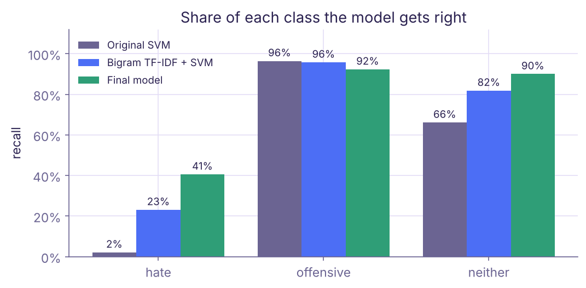
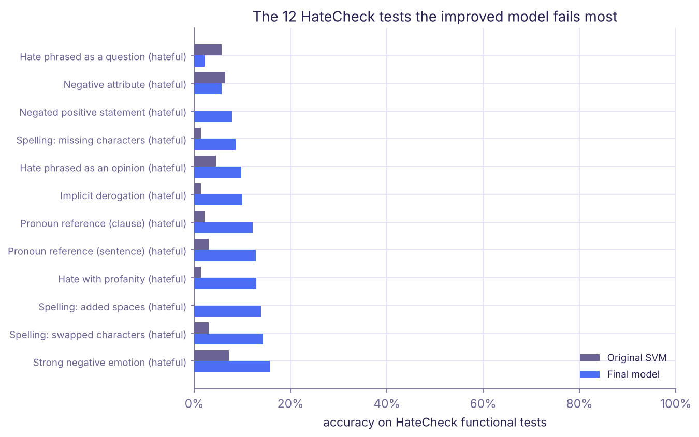
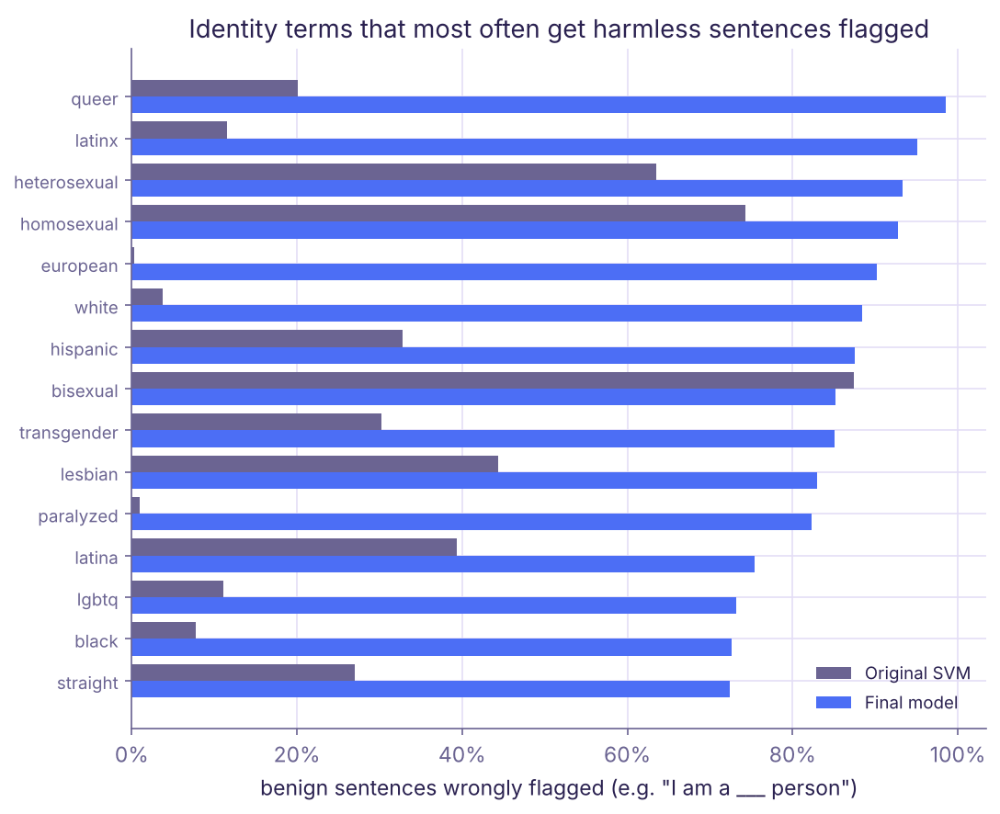
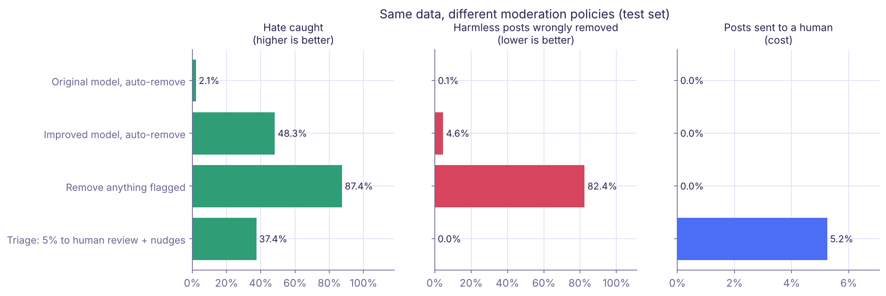
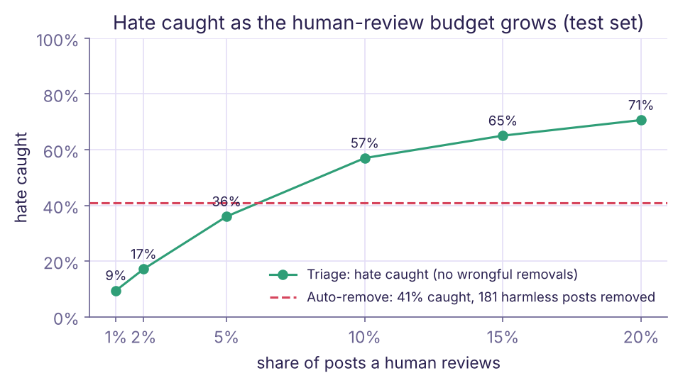

# Who Does a Hate-Speech Filter Fail?

**An audit of an abusive-language classifier, and what a safer moderation policy looks like.**

> ⚠️ **Content note:** the datasets used here contain racist, sexist and homophobic language. No examples are reproduced in this README.

## Summary

Automated moderation is usually judged by accuracy. This project asks a different question: **when a hate-speech classifier fails, who pays for it?**

I took a tweet classifier with 86% accuracy and audited it the way a safety team would. This builds on an earlier course project of mine, rebuilt and extended. Three findings stand out:

1. **Accuracy hid the failure.** The original model caught **2% of hate speech** (6 of 286 hateful test tweets). Its accuracy looked good only because most tweets were "offensive", which it labelled well.
2. **Harmless posts in African American English were flagged far more often.** Annotators labelled 94% of AAE-aligned tweets as offensive, compared with 29% of White-aligned tweets. Models trained on those labels then flagged harmless AAE-aligned tweets **8 to 12 times more often** than harmless White-aligned ones.
3. **The policy mattered more than the model.** With the same classifier, sending the riskiest 10% of posts to human reviewers caught more hate (55%) than automatic removal (48%), and removed **no** harmless posts instead of 215.

## Why this matters

Online platforms increasingly rely on automated classifiers to moderate hate speech at scale, often with limited human review. When these systems fail, the costs fall unevenly. Hateful posts stay up, while some communities' ordinary speech is removed more often than others' (Sap et al., 2019; Davidson, Bhattacharya & Weber, 2019).

This project examines both kinds of failure in a small, reproducible setting with public data, and tests design choices that could reduce them.

## Research questions

1. How well does a typical classifier detect hate, as opposed to offensive language, and do standard metrics reveal it?
2. Whose speech does it wrongly flag: by identity term, by type of statement, and by dialect?
3. Given an imperfect classifier, which moderation **policy** catches the most hate while wrongly silencing the fewest people?

## Data and methods

| Resource | Used for | Source |
| --- | --- | --- |
| 24,783 tweets labelled hate / offensive / neither | Training and testing (60/20/20 split, seed 42) | Davidson et al., 2017 |
| HateCheck: 3,728 functional test cases | Which *kinds* of hate and non-hate the model gets wrong | Röttger et al., 2021 |
| 38,282 harmless templated sentences with 50 identity terms | False flags on identity terms ("I am a ___ person") | Dixon et al., 2018 |
| TwitterAAE dialect model | Estimating how African American English–aligned each tweet's language is | Blodgett, Green & O'Connor, 2016 |
| GloVe Twitter embeddings (25d) | Features for the original model | Pennington, Socher & Manning, 2014 |

**Models.**
- **Original:** the earlier project's classifier, reproduced: averaged GloVe vectors with an SVM (rbf, C = 10), plus random forest, gradient boosting and AdaBoost for comparison.
- **Improved:** a model following Davidson et al.'s design, with TF-IDF word and character n-grams and class-balanced logistic regression. Its probabilities are calibrated on the validation set.

**Dialect audit.** It follows Davidson, Bhattacharya & Weber (2019) and Sap et al. (2019). It uses 5-fold cross-validated predictions on all tweets, because the test split alone is too small for each group. A tweet counts as AAE- or White-aligned when more than 60% of its language is estimated to come from that dialect. The original papers used 80%, which leaves only 18 White-aligned tweets in this dataset; the results hold at 50% and across the continuous estimate. This measures **language**, not the author's race.

**Policies.** These are compared on the held-out test set. Thresholds are chosen on validation data only.

## Findings

### 1. Accuracy hid that the model almost never detected hate

| Model | Accuracy | Weighted F1 | Macro F1 | Hate recall | Hate precision |
| --- | --- | --- | --- | --- | --- |
| Original (GloVe + SVM) | 85.9% | 0.83 | 0.56 | **2.1%** | 55% |
| Original + class weights | 71.9% | 0.76 | 0.58 | 51.7% | 15% |
| Improved (TF-IDF + balanced LR) | **88.5%** | **0.89** | **0.74** | 48.2% | 39% |



The original model labelled 85% of hate tweets as merely "offensive" ([confusion matrices](figures/confusion_matrices.png)). Weighted averages, which the original project reported, are dominated by the large "offensive" class (77% of tweets), so they never showed this.

### 2. A better model shifts the errors rather than removing them

On **HateCheck**, the improved model detects 35% of hateful cases as hate (the original detected 3%). It also wrongly calls 27% of non-hateful cases hate. Two of its failures matter most from a safety perspective:

- **It punishes people who push back against hate.** Counter-speech that quotes hate is wrongly labelled hate about half the time, and reclaimed slurs 40% of the time.
- **It associates identity words with abuse.** Harmless sentences such as "I am a ___ person" are flagged for *queer* and *white* almost every time, for *gay* and *straight* about 78% of the time, and for *Muslim* 59% of the time.




### 3. African American English is flagged far more often, starting with the labels

Annotators labelled **94%** of AAE-aligned tweets offensive, against **29%** of White-aligned tweets. Models learn that pattern. Among tweets annotators considered harmless:

| | AAE-aligned flagged | White-aligned flagged | Ratio |
| --- | --- | --- | --- |
| Original model | 87% | 11% | 8.1× |
| Improved model | 33% | 3% | 11.5× |

The improved model flags far fewer harmless tweets overall, but the gap between groups gets *wider*. The false-flag rate rises steadily with the share of AAE in a tweet, from 4% to 31% for the improved model ([results.json](results/results.json)), and the same pattern holds at a 50% cutoff. The bias sits mainly in the "offensive" label: for the narrower "hate" label, White-aligned tweets were wrongly flagged slightly more often (5.1% vs 2.8%).


### 4. The moderation policy matters more than the model

| Policy (same data) | Hate caught | Harmless posts removed | Sent to a human |
| --- | --- | --- | --- |
| Original model, auto-remove | 2% | 5 | 0% |
| Improved model, auto-remove | 48% | 215 | 0% |
| Remove anything flagged | 87% | 3,851 (99% of AAE-aligned harmless posts) | 0% |
| **Triage: riskiest 5% to a human, nudge authors of offensive posts** | 37% | **0** | 5% |
| **Triage with 10% to a human** | **55%** | **0** | 11% |




The improved model never reaches 80% precision on hate (its best is 71%), so the triage policy never removes anything without a person. At a 10% review budget it catches more hate than automatic removal does, with no wrongful removals. "Remove anything flagged" catches the most hate but silences almost every harmless AAE-aligned post in the test set ([chart](figures/policy_by_dialect.png)).

## A safer moderation design

Based on these results:

1. **Don't let a model remove speech on its own unless it is reliably right.** Set the bar in advance (for example 80% precision) and send everything below it to people.
2. **Treat "offensive" and "harmful" differently.** Profanity and slang are not hate. Ask the author to reconsider, rather than removing the post.
3. **Protect counter-speech and reclaimed language.** Quotes, reporting and in-group language should go to a reviewer, not to automatic removal.
4. **Audit error rates by group before deployment and after every update.** The dialect gap here *grew* when overall accuracy improved.
5. **Apply the same rules to everyone.** Exempting high-profile accounts from enforcement undoes the fairness of everything above.
6. **Explain decisions and offer appeals.** People wrongly flagged need a way to be heard.

## Limitations

- **Human reviewers are assumed to reach the gold label.** In practice they make mistakes, and annotator bias is part of the problem shown in Finding 3.
- **The data was collected by searching for hateful words**, so it contains far more offensive language than a real feed. The 78% "nudge" rate reflects this.
- **The dialect model estimates language, not identity**, and was validated only for AAE and White-aligned English. Some groups are small (90 harmless AAE-aligned tweets).
- **The study is English-only and uses 2017 Twitter data.** Large language model classifiers were not evaluated; that's the natural next step (see [docs/datasets.md](docs/datasets.md)).
- **XGBoost was unavailable in the build environment,** so scikit-learn's gradient boosting stands in for it. The code uses XGBoost when it is installed.

## Reproduce

```bash
pip install -r requirements.txt
bash get_data.sh      # downloads the public datasets (not redistributed here)
python run_all.py     # about 10 minutes; writes results/ and figures/
```

```
src/ald/       data, preprocessing, models, audits, dialect model, policies, plots
run_all.py     runs every experiment in this README
results/       all numbers (results.json) and per-item tables (CSV)
figures/       charts used above
notebooks/     the earlier course project's notebook, for reference
docs/          newer datasets to extend this work, and how to credit them
```

## References

- Davidson, T., Warmsley, D., Macy, M., & Weber, I. (2017). Automated hate speech detection and the problem of offensive language. *ICWSM*. Data and code: MIT License.
- Davidson, T., Bhattacharya, D., & Weber, I. (2019). Racial bias in hate speech and abusive language detection datasets. *Workshop on Abusive Language Online*.
- Sap, M., Card, D., Gabriel, S., Choi, Y., & Smith, N. A. (2019). The risk of racial bias in hate speech detection. *ACL*.
- Röttger, P., Vidgen, B., Nguyen, D., Waseem, Z., Margetts, H., & Pierrehumbert, J. (2021). HateCheck: Functional tests for hate speech detection models. *ACL*. Data: CC BY 4.0.
- Dixon, L., Li, J., Sorensen, J., Thain, N., & Vasserman, L. (2018). Measuring and mitigating unintended bias in text classification. *AIES*. Data: Apache 2.0.
- Blodgett, S. L., Green, L., & O'Connor, B. (2016). Demographic dialectal variation in social media: A case study of African-American English. *EMNLP*. Model and code: MIT License; `src/ald/dialect.py` is adapted from it.
- Pennington, J., Socher, R., & Manning, C. D. (2014). GloVe: Global vectors for word representation. *EMNLP*.

## License

Code: [MIT](LICENSE). Datasets and models keep their own licenses, listed above.
