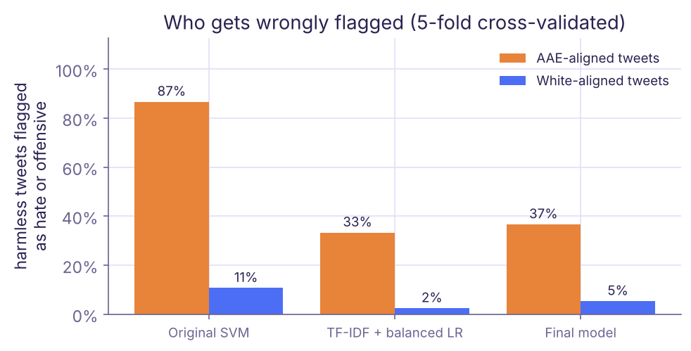

# Who Does a Hate-Speech Filter Fail?

This project looks at how well machine learning models actually detect hate speech, and whether they treat different types of language fairly.

It builds on an earlier course project where I trained models to classify tweets as hate speech, offensive language, or neither. I wanted to revisit that work and look beyond accuracy to understand where the models were making mistakes.

> **Content note:** the datasets contain racist, sexist and homophobic language. No examples are reproduced here.

## What I Did

I used a dataset of around 25,000 labelled tweets (Davidson et al., 2017) to compare my original classifier with an improved model using TF-IDF and logistic regression, also trained on a sample of everyday tweets.

I then tested both models on HateCheck and on harmless sentences mentioning identity groups, to see how they handled identity-related language and counter-speech. To check for dialect bias, I used a dialect model to estimate how closely each tweet's language matches African American English (AAE).

Finally, I compared different moderation approaches to see whether human review could help reduce wrongful removals.

## What I Found

**High accuracy didn't mean the model was good at detecting hate.**
My original model had almost 86% accuracy but only caught 2% of actual hate speech. Most hateful tweets were classified as simply offensive.

**The models also showed bias in what they flagged.**
The improved model still flagged 37% of harmless AAE-aligned tweets as offensive or hateful, compared with 5% of harmless White-aligned tweets. This measures language patterns, not the author's race.



**How a platform uses the model matters too.**
In my simulation, sending roughly 10% of the riskiest posts to human reviewers caught 56% of hate speech, compared with 41% through automatic removal. It also avoided wrongful removals, assuming reviewers made correct decisions.

## What I Took Away

The biggest takeaway was that improving a model's accuracy doesn't automatically make it fairer or safer. Models can learn biases from their training data, and even a better-performing classifier can still make harmful mistakes.

This project made me think more about how AI systems should be evaluated, especially when their decisions can affect people's ability to express themselves.

The results are based on older Twitter data and simulated moderation decisions, so they aren't meant to represent how a real platform would perform.

## Running the Project

```bash
pip install -r requirements.txt
bash get_data.sh
python run_all.py
```

This downloads the datasets, runs the experiments (about 10 minutes), and writes the results to `results/` and the figures to `figures/`. Newer datasets for extending this work are listed in [docs/datasets.md](docs/datasets.md).

## Data and Credits

- Davidson, T., Warmsley, D., Macy, M., & Weber, I. (2017). Automated hate speech detection and the problem of offensive language. *ICWSM*.
- Röttger, P., et al. (2021). HateCheck: Functional tests for hate speech detection models. *ACL*.
- Dixon, L., et al. (2018). Measuring and mitigating unintended bias in text classification. *AIES*.
- Zampieri, M., et al. (2019). Predicting the type and target of offensive posts in social media (OLID). *NAACL*. Used via TweetEval (Barbieri et al., 2020).
- Blodgett, S. L., Green, L., & O'Connor, B. (2016). Demographic dialectal variation in social media: A case study of African-American English. *EMNLP*. `src/ald/dialect.py` is adapted from their code.
- Davidson, T., Bhattacharya, D., & Weber, I. (2019) and Sap, M., et al. (2019), whose dialect-bias audits this one follows.
- Pennington, J., Socher, R., & Manning, C. D. (2014). GloVe: Global vectors for word representation. *EMNLP*.

## License

Code is available under the [MIT License](LICENSE). The datasets and pretrained models follow their respective licenses.
